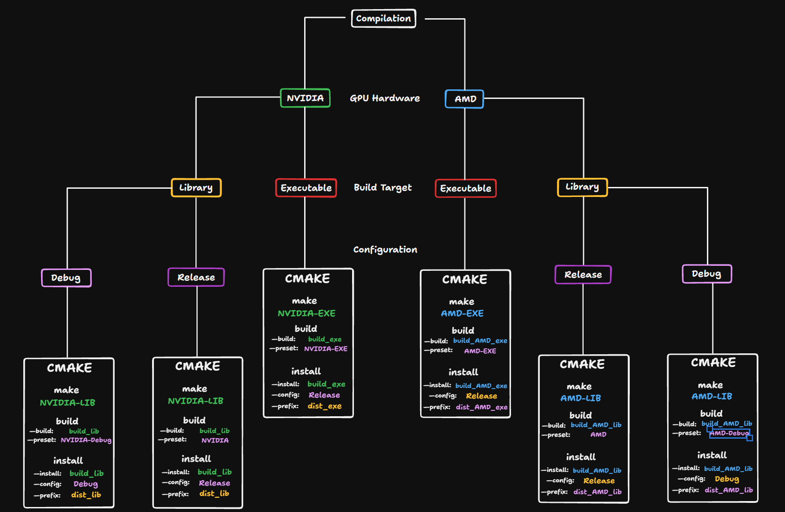

# CloudWeatherSimulation
This project is a weather simulation created in C++ with CUDA for the GPU.  
It has been a project of mine for over a year, and I enjoy working on it.  
Most of the code was created from scratch, AI was only used for help with debugging errors and CMAKE. 


**How does it work?**  
The project is basically a fluid simulation with extra rules applied to it creating for the weather aspect.  
Rules like when clouds should happen or rain should start to fall.  
The information of all clouds and rain is later then passed to the renderer which ray marches through the grid. 

The simulation and render code is done on the GPU, using CUDA (which is [hipified](https://rocm.docs.amd.com/projects/HIPIFY/en/latest/) to also support AMD GPUs).  

**What can I do with it?**  
This library can be used to simulate realistic weather scenarios and render it accordingly.  
These simulation can be saved and later loaded during for example gameplay.  
Besides only viewing the clouds, you can also look at the specifics that are going on during the simulation in real-time. This includes temperature, wind, all transitions from and to different states (cloud, rain, snow, etc). 

**How do I use it?**  
A broader section is [written below](#using-the-library)


Feel free to reach out for further questions or remarks. 


## Library or Executable
This project is made as library, usable in other projects to create and render clouds.  
Yet, it has many features of its own, which is why it is also possible to use as executable.  
The executable has another simple project compiled with the library which just calls the functions from the library.


## Install

**Pre-build executables** can be found [on my website](https://finntie.github.io), this skips the need to compile the whole source code if you just want to check out the project and play with the simulation.

To use this project as a **library** for your own program, there are many different options to choose from, this is to make sure the library is compiled correctly for your target hardware.  
The next few steps are for installing the library or generating an executable.  
Installing this library yourself means there are some specific programs needed to be installed in order for the code to compile:

### Tools Necessary to Compile
  

**General**  
- **[Visual Studio 2022](https://visualstudio.microsoft.com/vs/older-downloads/#visual-studio-2022-and-other-products)**, Version 2022 is needed for CUDA 12.9 to run.

**NVIDIA Build**  
- **[CUDA Toolkit 12.9](https://developer.nvidia.com/cuda-12-9-0-download-archive)** To compile for NVIDIA, the CUDA toolkit version 12.9 is needed for the CUDA code, this could take a bit longer to download.
- **HIP headers**, These headers to redirect HIP functions to CUDA, will be installed automatically if it cannot find the HIP files in the ROCm path.

**AMD Build**  
- **[ROCm](https://rocm.docs.amd.com/en/latest/install/rocm.html?fam=all&w=compute&os=windows&i=pip&windows-ver=11)**, if building for **AMD** from **windows**, ROCm does need to be installed. Compiling from **AMD** can skip this step. 
- **[HIP 7.2](https://rocm.docs.amd.com/projects/install-on-windows/en/latest/install/install.html)**, The full HIP SDK is needed to compile the HIP code. Version 7.2 is needed with plugins to Visual Studio 2022.

**Intel**  
Not supported (yet?).  

### Cloning

clone the source code into any empty folder.

This can be done simply by right clicking the empty folder and opening a terminal,  
use the following command to clone the source code into the folder:
```
git clone CLONE_URL
```
(Of course replace CLONE_URL with the copied URL)

Now that we have the source code, we can start compiling it into our desired result.

### Compiling

There are multiple compilation routes, they differ based on GPU hardware, build target and configuration.  
To make it easy to get the correct set of commands, the next image shows which path to take based on your desires. 



You can compile the library using the CMakelist.txt with presets defined in the CMakePresets.json file.

use the settings from the image to compile the source code.  
For example, for an NVIDIA executable, you use the preset 'NVIDIA-EXE' for both the first and second step, 'build_exe' for the build location, 'Release' as configuration and 'dist_exe' as result location.   
For the executables, you can also get them for debug using the 'NVIDIA-Debug' or 'AMD-Debug' preset together with --config being 'Debug'.


#### **1.**   
Open a terminal at the location of the main CMakelist.txt file at the root.

#### **2.**  
run the **make** command: 
```
cmake --preset NVIDIA-EXE
```
This will build the library into the 'build_exe' folder for visual studio 2022 and cuda version 12.9.

#### **3.**  
Now actually run the **build** using the command:
```
cmake --build build_exe --preset NVIDIA-EXE
```
This command will compile and build the program. 

Note: for NVIDIA, a warning like **warning C4005** about **macro redefinition** may occure quite a lot, this is not harmful for the application. 

#### **4.**   
**Install** the final result giving the lib and exe together with assets:
```
cmake --install build_exe --config Release --prefix dist_exe
```
This will install the build with the Release configuration inside a new folder called 'dist_exe'.


<br>

**<span style="color:yellow">If compiling for AMD fails</span>**, one reason could be that visual studio 2026 (or another version) is building instead of visual studio 2022.  
To (hopefully) fix this, run the bat file located in the same folder in the terminal:
```
build_amd_exe.bat
or
build_amd_lib.bat
```
The bat file searches for visual studio 2022 being installed and executes the vcvars64.bat in the visual studio location.  
This basically loads the visual studio 2022 compiler into this terminal.

This makes sure the preset is run with visual studio 2022.
If it does not work, contact me with the issue, so I may (help) resolve it.

**If using the .bat, you may skip step 3. and go to step 4 istead.**

<br>

### External Files and Libraries needed

This library makes use of glfw, OpenGL, and ImGui.  
Thus, the following files are expected to be added and linked when using the library;


- [ImGui](https://github.com/finntie/skewTCloudSim/tree/useLib/cloudWeatherSim/external/imgui), Specific ImGui (Implot and ImGuizmo) files I use for the library
- [Glad](https://glad.dav1d.de)
- [GLFW](https://www.glfw.org/download)
- **cudart_static.lib**, CUDA toolkit library needed if building for NVIDIA. Find it using the '$(CUDA_PATH)' macro in additional library directories. 


### Frequent Errors

...

## Important

**Assets**  
Make sure the 'assets' folder next to the library is also copied over to the working directory.  
These assets are used to save ImGui data and has a custom font which is used, else ImGui will use the default font and icons will not load.  

**Depth Buffer**  
The depth buffer has to be logarithmic (for now) to make sure that the far plane can be extended much further. 
This means that for your possible shaders, you will have to use some different code: [StackOverflow discussion](https://stackoverflow.com/questions/22364930/logarithmic-depth-buffer-opengl) on how to do it.


## Limitations

- As the clouds are post-processing, it is not possible to show the clouds in any reflective objects you draw.

- The shadows from clouds do not take into account blocking of other geometry, making the underside of object also have shadows from clouds. 


## Using the Library

Inside the library, there are multiple options to choose from.  
It is mainly split up in 2 catergories: **Simulating** and **Viewing**.

### Simulating

Simulating clouds requires a starting position; a blanc environment can mean many things, depending on the temperature, moist and wind speed, many different scenarios can unfold.  
There are multiple options of how to decide your starting environment:  
1. **Create your own from scratch**  
    Use the Skew-T editor to decide the temperature and dew point for each height in the environment. Use the hodograph to set the wind speed.  
    This requires knowledge on [Skew-T diagrams](https://www.weather.gov/source/zhu/ZHU_Training_Page/convective_parameters/skewt/skewtinfo.html) which could be difficult to start with.
2. **Use observed soundings**  
    Every day, countries will send out weather balloons up high to measure the environment. You may use this data to try and simulate the weather of that day.  
    *(Note: weather will never be 1-to-1 of the observed day, due to so limitations and many factors uncounted for in the simulation)*.  
3. **Load user-created soundings**  
    Load environments that you made or someone else made.  
    (**Coming soon:** default environments for easy and interesting pre-set scenarios).

Now that an environment is loaded, you may start playing it by pressing the play button.  
The simulation pace is based on real time, meaning it is pretty slow, put the simulation speed between 1 and 100 to see results way quicker.  

Play around with all the features there are to be seen, for example the saving (recording), visualizing the environment using the debug viewer or edit the simulation with the editor.  

### Rendering

Visualize some of the simulations you or someone else has made.  
When using the cloud viewer, you can look through the saved simulations, viewing them from the first until the last frame.  
You can play with the render settings to change the look of the clouds.  


### Code

If wanting to use the library's code, you will mainly work with saved simulation that you want to render during the gameplay.  
To start, take a look at the [game example](https://github.com/finntie/skewTCloudSim/tree/useLib/Game).  
**More in depth code explainer will come soon**